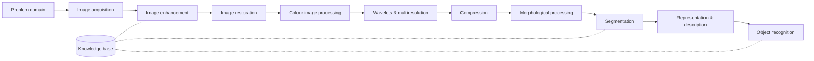
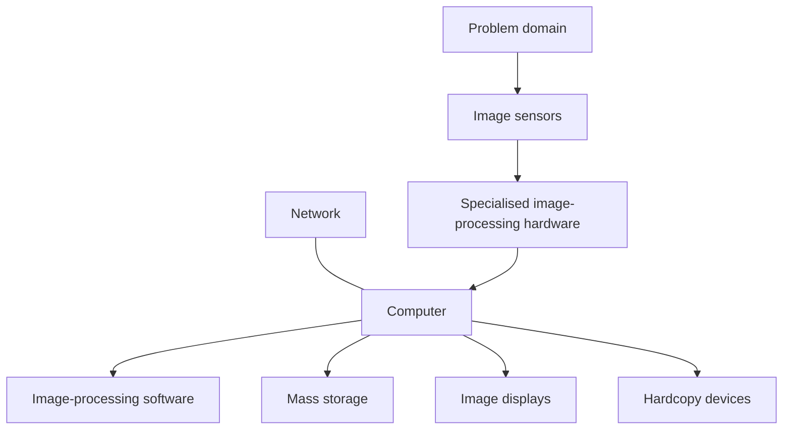
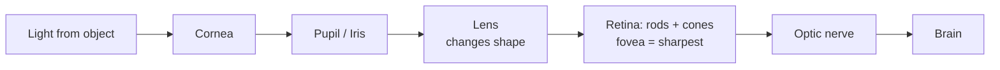

# Unit 1 · Fundamentals and Spatial-Domain Enhancement

> **Exam weight:** the heaviest unit. In 2025-26 it gave 8 of the 16 parts. Histogram equalization has been asked in **every** end-sem paper.

**Prefer to watch first?** [Video lectures for Unit 1 →](#videos/unit1)

Based on the class Mid-1 notes PDF (§1.1–1.16), with the end-sem depth added.

## 1.1 What is Digital Image Processing

**Definition.** An image is a two-dimensional function **f(x, y)**, where x and y are spatial coordinates and the value of f at any point is the **intensity (grey level)** there. When x, y and f are all finite and discrete, the image is a **digital image**. **Digital image processing** means processing digital images by means of a digital computer.

Each element of a digital image is a **pixel** (picture element), with a location and a value.

**Three levels of processing:**

| Level | Input → Output | Example |
|---|---|---|
| Low-level | image → image | noise removal, contrast enhancement, sharpening |
| Mid-level | image → attributes | segmentation, edges, object description |
| High-level | attributes → understanding | recognising a face, reading a number plate |

**Motivation:** (1) improve pictorial information for human interpretation (medical X-rays, satellite pictures); (2) process image data for storage, transmission and machine perception (OCR, fingerprint matching, robot vision). Unlike the human eye, imaging machines cover the entire electromagnetic spectrum, from gamma rays to radio waves.

## 1.2 Fundamental steps in DIP  ⭐ (2017, 2018, 2019)


*Fig.: Fundamental steps in digital image processing (all steps interact with the knowledge base).*

1. **Image acquisition:** capturing the image with a sensor and digitising it; may include scaling.
2. **Image enhancement:** making the image more suitable for a specific application (subjective): contrast, sharpening.
3. **Image restoration:** improving the image using mathematical/probabilistic models of degradation (objective).
4. **Colour image processing:** colour models and processing in colour.
5. **Wavelets and multiresolution processing:** representing images at several resolutions.
6. **Compression:** reducing storage or bandwidth (JPEG).
7. **Morphological processing:** tools for extracting image components useful for describing shape.
8. **Segmentation:** partitioning an image into its constituent parts or objects.
9. **Representation and description:** converting segmented data to a form suitable for computers (boundary or region) and extracting features.
10. **Recognition:** assigning a label (e.g. "vehicle") to an object based on its descriptors.
11. **Knowledge base:** prior knowledge about the problem domain that guides every module.

## 1.3 Applications (2019: in medicine)

- **Gamma-ray imaging:** nuclear medicine (bone scans, PET), astronomy.
- **X-ray imaging:** chest X-rays, angiography, CT, industrial inspection of circuit boards.
- **Ultraviolet:** fluorescence microscopy, industrial inspection.
- **Visible and infrared:** photography, remote sensing (LANDSAT), fingerprints, number-plate reading, weather.
- **Microwave:** radar imaging through clouds.
- **Radio:** MRI in medicine, radio astronomy.
- **Others:** ultrasound (foetus scanning), electron microscopy, document OCR, face recognition, robotics, video surveillance.

**In medicine** specifically: CT/MRI reconstruction, enhancement of X-rays (histogram equalization, sharpening), noise removal in ultrasound (median filter), segmentation of tumours, measuring organ size, skeletonisation of blood vessels (thinning), computer-aided diagnosis.

## 1.4 Components of an image processing system  ⭐ (2017)



1. **Image sensors:** a physical device sensitive to energy radiated by the object, plus a digitiser that converts its output to digital form.
2. **Specialised hardware:** digitiser + ALU front-end that does fast operations such as averaging, at video rate.
3. **Computer:** general-purpose PC to supercomputer.
4. **Software:** specialised modules (e.g. MATLAB Image Processing Toolbox, OpenCV).
5. **Mass storage:** short-term (frame buffers), online (disks) and archival (tapes, optical). A 1024×1024 8-bit image needs 1 MB.
6. **Image displays:** colour monitors.
7. **Hardcopy:** laser printers, film cameras, inkjet.
8. **Networking:** transmission bandwidth is the key concern, which is why compression matters.

## 1.5 Elements of visual perception  ⭐ (2025-26 Q1, Mid-1)

### Structure of the eye
- Nearly a sphere, about 20 mm in diameter, enclosed by three membranes: **cornea and sclera** (outer), **choroid** (middle; contains the **iris**, which controls the pupil, 2–8 mm), and **retina** (inner).
- **Lens:** focuses light on the retina; absorbs about 8% of visible light.
- **Retina receptors:**
  - **Cones:** 6–7 million, concentrated in the **fovea**, sensitive to **colour**, work in bright light (**photopic** vision). Each cone has its own nerve end, so fine detail is resolved.
  - **Rods:** 75–150 million, spread over the retina, no colour, work in dim light (**scotopic** vision). Several rods share a nerve, so they give an overall picture.
- **Blind spot:** where the optic nerve leaves; no receptors.



### Image formation in the eye
The distance between the lens and the retina is fixed (about 17 mm). To focus, the **ciliary body changes the shape of the lens**: flatter for distant objects, thicker for near ones. Focal length varies from about 17 mm to 14 mm.

**Example:** a 15 m tall tree seen from 100 m. By similar triangles, 15/100 = h/17, so the retinal image height h = 2.55 mm.

### Brightness adaptation and discrimination  ⭐ (2025-26 Q1b)
- The eye can adapt to a huge range of intensities, about **10<sup>10</sup>**, from the scotopic threshold to the glare limit.
- **Subjective brightness** is a **logarithmic** function of the light intensity entering the eye.
- The eye cannot work over the whole range at once. It does it by **brightness adaptation**: at any moment it covers only a small range around the current **adaptation level B<sub>a</sub>**; below a level B<sub>b</sub> everything looks black.
- **Brightness discrimination:** the ability to tell two intensities apart, measured by the **Weber ratio ΔI<sub>c</sub>/I**, where ΔI<sub>c</sub> is the just-noticeable increment at background intensity I. Small Weber ratio = good discrimination. Discrimination is poor at low illumination (rods) and improves at high illumination (cones).
- The eye can distinguish only about **one to two dozen** intensity levels at a given adaptation level.

### Perceived brightness is not a simple function of intensity
1. **Mach bands:** at the boundary between strips of constant intensity, the eye sees undershoot and overshoot (a darker band on the dark side, a brighter band on the bright side).
2. **Simultaneous contrast:** the same grey square looks darker on a white background and lighter on a black background.
3. **Optical illusions:** the eye fills in non-existent lines or misjudges lengths (Müller-Lyer, Kanizsa triangle).

## 1.6 A simple image model  ⭐ (2017 "image model")

The intensity f(x, y) of a seen object is the product of two components:

**f(x, y) = i(x, y) · r(x, y)**, with 0 < f < ∞

- **i(x, y): illumination**, the amount of source light falling on the scene; 0 < i < ∞. It is determined by the source (sunny day ≈ 90,000 lm/m², full moon ≈ 0.1 lm/m²). It varies **slowly** (low frequency).
- **r(x, y): reflectance**, the fraction reflected by the object; 0 < r < 1 (0 = total absorption, 1 = total reflectance). Black velvet ≈ 0.01, snow ≈ 0.93. It changes **quickly** at object edges (high frequency).

The grey level ℓ of a monochrome image lies in [L<sub>min</sub>, L<sub>max</sub>], shifted in practice to **[0, L−1]** (0 = black, L−1 = white). This is the **grey scale**. The i·r model is the basis of **homomorphic filtering** (Unit 2).

**Image sensing:** single sensor (photodiode + mechanical motion), sensor strips (flatbed scanners, CT rings), and **sensor arrays (CCD/CMOS)** in digital cameras. The sensor output is a continuous voltage waveform; it must be sampled and quantized.

## 1.7 Sampling and quantization  ⭐⭐ (2017, 2018, 2019, Mid-1)


- **Sampling:** digitising the **coordinate** values. It decides the **spatial resolution** (number of pixels, M × N). Too few samples cause **checkerboard / pixelation** and **aliasing**.
- **Quantization:** digitising the **amplitude** (intensity) values. It decides the **intensity (grey-level) resolution**, L = 2<sup>k</sup> levels. Too few levels cause **false contouring** (ridge-like bands in smooth areas).
- **Storage:** b = M × N × k bits. For example, 1024 × 1024 × 8 = 8,388,608 bits = 1 MB.
- **Digital image as a matrix:** f(0,0) … f(0,N−1) down to f(M−1,0) … f(M−1,N−1).
- **2-D sampling theorem (2018):** a band-limited image whose spectrum is zero outside |u| < u<sub>max</sub>, |v| < v<sub>max</sub> can be exactly reconstructed from its samples if the sampling intervals satisfy Δx < 1/(2u<sub>max</sub>) and Δy < 1/(2v<sub>max</sub>) (the Nyquist rate). Reconstruction = passing the samples through an ideal low-pass filter (interpolation with a sinc function). Sampling below this rate gives **aliasing** (moiré patterns).
- **Isopreference curves (Huang):** images with more detail need fewer grey levels; the curves become more vertical as detail increases.

## 1.8 Relationships between pixels (Mid-1 numerical)

- **N<sub>4</sub>(p):** the 4 horizontal and vertical neighbours (x±1, y), (x, y±1).
- **N<sub>D</sub>(p):** the 4 diagonal neighbours (x±1, y±1).
- **N<sub>8</sub>(p) = N<sub>4</sub> ∪ N<sub>D</sub>.**
- **Adjacency** (V = set of grey values that count): 4-adjacent if q ∈ N<sub>4</sub>(p); 8-adjacent if q ∈ N<sub>8</sub>(p); **m-adjacent (mixed)** if q ∈ N<sub>4</sub>(p), or q ∈ N<sub>D</sub>(p) **and** N<sub>4</sub>(p) ∩ N<sub>4</sub>(q) has no pixel with value in V. m-adjacency removes the ambiguity of multiple 8-paths.
- **Path length** = number of steps = pixels − 1.
- **Distances:** Euclidean D<sub>e</sub> = √((x−s)² + (y−t)²); **city-block D<sub>4</sub>** = |x−s| + |y−t| (diamond); **chessboard D<sub>8</sub>** = max(|x−s|, |y−t|) (square).

## 1.9 Basic grey-level transformations  ⭐ (2019)

Spatial domain processing: **g(x, y) = T[f(x, y)]**. When the neighbourhood is 1×1, T is a **grey-level (intensity) transformation** s = T(r).

| Transformation | Formula | Use |
|---|---|---|
| **Image negative** | s = L − 1 − r | white/grey detail in dark regions (mammograms) |
| **Log** | s = c · log(1 + r) | expands dark values, compresses bright (Fourier spectrum display) |
| **Inverse log** | opposite of log | expands bright values |
| **Power-law (gamma)** | s = c · r<sup>γ</sup> | γ < 1 brightens (like log), γ > 1 darkens; **gamma correction** of CRT monitors, MRI enhancement |


*(In the exam draw the graph: input r on the x-axis 0 to L−1, output s on the y-axis; identity is the diagonal, negative is the reverse diagonal, log bends up, nth-root up, nth-power down.)*

## 1.10 Piecewise-linear transformations  ⭐⭐ (2018, 2025-26)

**Advantage:** the form can be arbitrarily complex. **Disadvantage:** needs more user input.

### (a) Contrast stretching
Low-contrast images come from poor illumination, small sensor dynamic range or wrong aperture. Contrast stretching **expands the range of intensity levels** so it covers the full range.

The transformation is controlled by two points **(r<sub>1</sub>, s<sub>1</sub>)** and **(r<sub>2</sub>, s<sub>2</sub>)**:
- r<sub>1</sub> = s<sub>1</sub> and r<sub>2</sub> = s<sub>2</sub>: identity (no change).
- r<sub>1</sub> = r<sub>2</sub>, s<sub>1</sub> = 0, s<sub>2</sub> = L−1: **thresholding** (binary image).
- Intermediate values: various degrees of spread.
- r<sub>1</sub> ≤ r<sub>2</sub> and s<sub>1</sub> ≤ s<sub>2</sub> keeps the function single-valued and increasing.
- Common choice: (r<sub>1</sub>, s<sub>1</sub>) = (r<sub>min</sub>, 0), (r<sub>2</sub>, s<sub>2</sub>) = (r<sub>max</sub>, L−1): **min-max stretching**, s = (r − r<sub>min</sub>)(L−1)/(r<sub>max</sub> − r<sub>min</sub>).

Three line segments: s = (s<sub>1</sub>/r<sub>1</sub>)·r for r < r<sub>1</sub>; s = s<sub>1</sub> + (s<sub>2</sub>−s<sub>1</sub>)(r−r<sub>1</sub>)/(r<sub>2</sub>−r<sub>1</sub>) for r<sub>1</sub> ≤ r ≤ r<sub>2</sub>; s = s<sub>2</sub> + (L−1−s<sub>2</sub>)(r−r<sub>2</sub>)/(L−1−r<sub>2</sub>) for r > r<sub>2</sub>.

**Example:** an 8-bit image uses only 50–100. Min-max stretching: s = (r − 50) × 255/50. Then r = 50 → 0, r = 75 → 127.5 ≈ 128, r = 100 → 255.

### (b) Intensity-level (grey-level) slicing
Highlights a specific range [A, B] of intensities (e.g. water in satellite images, flaws in X-rays).
- **Approach 1:** high value for levels in [A, B], low value for everything else (binary output).
- **Approach 2:** brighten levels in [A, B], **leave the others unchanged** (background preserved).

### (c) Bit-plane slicing
An 8-bit pixel = 8 bits; the image can be split into **8 one-bit planes**, plane 0 (LSB) to plane 7 (MSB).
- Higher-order planes (4–7) hold most of the **visually significant data**; lower planes hold fine detail and noise.
- Plane 7 equals thresholding at 128.
- **Uses:** analysing the importance of each bit, deciding how many bits are needed for quantization, **compression** (reconstruct from planes 7, 6, 5, 4 only), steganography (hide data in the LSB).
- **Example:** pixel 194 = 11000010 → bit 7 = 1, bit 6 = 1, bit 1 = 1, others 0.

## 1.11 Histogram processing and equalization  ⭐⭐⭐ (every paper)

**Histogram:** for an image with levels 0 to L−1, h(r<sub>k</sub>) = n<sub>k</sub>, the number of pixels with level r<sub>k</sub>. **Normalised histogram** p(r<sub>k</sub>) = n<sub>k</sub>/MN (an estimate of probability; sums to 1).

| Image type | Histogram shape |
|---|---|
| Dark | concentrated at the low end |
| Bright | concentrated at the high end |
| Low contrast | narrow, in the middle |
| High contrast | spread over the full range, roughly uniform |

### Histogram equalization
**Idea:** find T so that the output histogram is (approximately) **uniform**, which spreads the levels over the full range and increases contrast **automatically** (no parameters).

Continuous form: **s = T(r) = (L−1) ∫<sub>0</sub><sup>r</sup> p<sub>r</sub>(w) dw** (the CDF), which gives p<sub>s</sub>(s) = 1/(L−1), uniform.

Discrete form: **s<sub>k</sub> = (L−1) Σ<sub>j=0</sub><sup>k</sup> p<sub>r</sub>(r<sub>j</sub>) = ((L−1)/MN) Σ n<sub>j</sub>**, then round to the nearest integer.

Conditions on T: (a) monotonically increasing (order of levels kept); (b) 0 ≤ T(r) ≤ L−1.

### Worked numerical (End-sem 2025-26 Q3b)
8×8 image, L = 8, n<sub>k</sub> = 8, 10, 10, 2, 12, 16, 4, 2 (total 64).

| r<sub>k</sub> | n<sub>k</sub> | p<sub>r</sub> | CDF | 7 × CDF | s<sub>k</sub> |
|---|---|---|---|---|---|
| 0 | 8 | 0.125 | 0.125 | 0.875 | 1 |
| 1 | 10 | 0.156 | 0.281 | 1.969 | 2 |
| 2 | 10 | 0.156 | 0.438 | 3.063 | 3 |
| 3 | 2 | 0.031 | 0.469 | 3.281 | 3 |
| 4 | 12 | 0.188 | 0.656 | 4.594 | 5 |
| 5 | 16 | 0.250 | 0.906 | 6.344 | 6 |
| 6 | 4 | 0.063 | 0.969 | 6.781 | 7 |
| 7 | 2 | 0.031 | 1.000 | 7.000 | 7 |

**New histogram:** level 0 → 0, 1 → 8, 2 → 10, 3 → 12, 4 → 0, 5 → 12, 6 → 16, 7 → 6 (total 64). The levels now spread over 1–7, so contrast has increased. The result is only approximately flat, because discrete levels cannot be split.

::: tip Exam drawing
Draw two bar graphs side by side: "Original histogram" and "Equalized histogram". That is the diagram for this question.
:::

## 1.12 Histogram specification (matching) and local enhancement

Equalization always aims at a flat histogram, which is not always best (e.g. an image with a large dark region becomes washed out). **Histogram specification** produces an image with a **specified** histogram p<sub>z</sub>(z).

**Procedure:**
1. Equalize the input: s<sub>k</sub> = T(r<sub>k</sub>) = (L−1) Σ p<sub>r</sub>.
2. Equalize the specified histogram: G(z<sub>q</sub>) = (L−1) Σ p<sub>z</sub>.
3. For each s<sub>k</sub>, find z<sub>q</sub> such that G(z<sub>q</sub>) is closest to s<sub>k</sub>: z = G<sup>−1</sup>(s).
4. Map every pixel r<sub>k</sub> → s<sub>k</sub> → z<sub>q</sub>.

**Local enhancement:** global methods may miss small regions. Define a neighbourhood, move its centre pixel by pixel, compute the histogram (or the **local mean m<sub>S</sub> and local standard deviation σ<sub>S</sub>**) of that neighbourhood, and transform only the centre pixel. Histogram statistics rule: g = E·f if m<sub>S</sub> ≤ k<sub>0</sub>M<sub>G</sub> and k<sub>1</sub>D<sub>G</sub> ≤ σ<sub>S</sub> ≤ k<sub>2</sub>D<sub>G</sub>, else g = f (enhances dark, low-contrast areas only).

## 1.13 Arithmetic and logic operations

- **AND, OR, NOT** for masking / region-of-interest (ROI) extraction (binary masks).
- **Image subtraction g = f − h:** highlights differences. Used in **digital subtraction angiography** (mask image before dye minus live image after dye leaves only the blood vessels), change detection, motion detection.
- **Image averaging:** g = (1/K) Σ g<sub>i</sub> of K noisy images of the same scene. If noise is uncorrelated with zero mean, E{g} = f and **σ²<sub>ḡ</sub> = σ²<sub>η</sub>/K**: noise falls as K grows. Used in astronomy (low-light imaging).
- **Multiplication / division:** shading correction (divide by the shading pattern), masking.
- **Scaling the result back:** f<sub>m</sub> = f − min(f); f<sub>s</sub> = (L−1)·f<sub>m</sub>/max(f<sub>m</sub>).

**Example (2017 numerical, element by element):** A = [1 2 / 5 5], B = [1 3 / 8 7] → A+B = [2 5 / 13 12], A−B = [0 −1 / −3 −2] (negative values are clipped to 0 or rescaled), A×B = [1 6 / 40 35] (element-wise), A/B = [1 0.67 / 0.63 0.71]. Division by a 0 pixel is avoided by adding a small value.

## 1.14 Basics of spatial filtering

A **mask (kernel, window, template)** w of size m × n (usually 3×3) is moved over the image; at each point the response is

**g(x, y) = Σ<sub>s=−a</sub><sup>a</sup> Σ<sub>t=−b</sub><sup>b</sup> w(s, t) · f(x+s, y+t)**   (correlation)

- **Correlation:** slide the mask as it is. **Convolution:** rotate the mask by 180° first. For symmetric masks they are the same.
- **Borders:** zero padding, replicate padding, or ignore the border pixels.

```
 w(-1,-1) | w(-1,0) | w(-1,1)
 w(0,-1)  | w(0,0)  | w(0,1)        mask placed on f(x-1..x+1, y-1..y+1)
 w(1,-1)  | w(1,0)  | w(1,1)
```

## 1.15 Smoothing filters: mean and order-statistic  ⭐ (2025-26 numerical)

**Linear (averaging / mean / low-pass) filter:** replace each pixel by the average of its neighbourhood. Box filter = (1/9)[1 1 1; 1 1 1; 1 1 1]; **weighted average** = (1/16)[1 2 1; 2 4 2; 1 2 1]. Reduces noise and fine detail, **blurs edges**.

**Order-statistic (non-linear) filters:** rank the pixels in the neighbourhood.
- **Median:** middle value. Excellent for **salt-and-pepper (impulse) noise**, with less blurring than the mean.
- **Max:** brightest point; removes **pepper** noise.
- **Min:** darkest point; removes **salt** noise.

**Worked example (2025-26 Q6a):** the 3×3 neighbourhood of f(2,2) = 5 is 6, 7, 0 / 5, 5, 2 / 6, 1, 2. Sorted: 0, 1, 2, 2, **5**, 5, 6, 6, 7.
- Mean = 34/9 = 3.78 ≈ **4**
- Max = **7**
- Median = 5th value = **5**
- (Min = 0)

## 1.16 Sharpening: the Laplacian  ⭐ (2019)

Sharpening highlights **fine detail and edges** (the opposite of smoothing: differentiation instead of averaging).

- **First derivative:** ∂f/∂x = f(x+1) − f(x). Non-zero along ramps, so it gives **thick edges**.
- **Second derivative:** ∂²f/∂x² = f(x+1) + f(x−1) − 2f(x). Gives a **double response** (a zero crossing) at edges and is stronger on fine detail.
- **Laplacian:** ∇²f = ∂²f/∂x² + ∂²f/∂y² = f(x+1,y) + f(x−1,y) + f(x,y+1) + f(x,y−1) − 4f(x,y).

**Masks:**
```
 0  1  0      1  1  1      0 -1  0     -1 -1 -1
 1 -4  1      1 -8  1     -1  4 -1     -1  8 -1
 0  1  0      1  1  1      0 -1  0     -1 -1 -1
```
**Sharpened image:** g = f − ∇²f if the centre coefficient is negative, g = f + ∇²f if it is positive. Composite mask: [0 −1 0; −1 5 −1; 0 −1 0].

**Example:** centre 50 with four neighbours of 10: ∇²f = 40 − 200 = −160, so g = 50 − (−160) = 210. The bright spot gets brighter.

**Unsharp masking and high-boost filtering:** blur the image, subtract the blurred version from the original to get a mask, add k × mask back: g = f + k(f − f̄). k = 1 is unsharp masking; k > 1 is high-boost.

**Gradient (first-order) operators:** |∇f| ≈ |G<sub>x</sub>| + |G<sub>y</sub>|. Roberts, Prewitt and Sobel masks (see Unit 4) are used for edge enhancement in industrial inspection.
