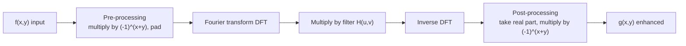
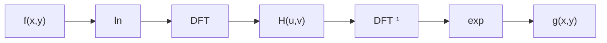
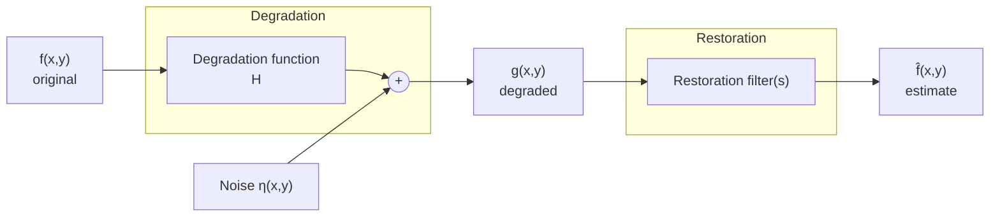

# Unit 2 · Frequency-Domain Enhancement and Image Restoration

> **Exam weight:** restoration (degradation model + noise models) is asked in almost every paper, word for word. Frequency filters and homomorphic filtering come next.

**Prefer to watch first?** [Video lectures for Unit 2 →](#videos/unit2)

## 2.1 Fourier transform and the frequency domain

**Why:** in the frequency domain, slowly varying parts of an image (smooth areas) are **low frequencies** and rapidly varying parts (edges, noise) are **high frequencies**. Filtering becomes a simple multiplication.

**2-D DFT** of an M × N image:

F(u, v) = Σx=0M−1 Σy=0N−1 f(x, y) · e−j2π(ux/M + vy/N)

**Inverse DFT:** f(x, y) = (1/MN) Σu Σv F(u, v) · ej2π(ux/M + vy/N)

- **Spectrum** |F(u,v)| = [R² + I²]1/2; **phase** φ = tan−1(I/R); **power spectrum** P = |F|².
- **F(0, 0) = MN × average grey level** (the DC component).
- **Centring:** multiply f(x,y) by (−1)x+y so F(0,0) moves to the centre (M/2, N/2).
- **Properties:** separability (2-D DFT = 1-D DFT on rows, then columns), translation, rotation, periodicity, conjugate symmetry, linearity, distributivity over addition (not multiplication), scaling.
- Display the spectrum as log(1 + |F|) because its range is huge.

## 2.2 Basics of filtering in the frequency domain

**G(u, v) = H(u, v) · F(u, v)**, then g(x, y) = Real{ℑ−1[G(u, v)]} × (−1)x+y.

Steps: (1) multiply by (−1)x+y to centre; (2) compute F(u,v); (3) multiply by a real, symmetric filter H(u,v) (a **zero-phase-shift** filter); (4) inverse DFT; (5) take the real part; (6) multiply by (−1)x+y. Zero-pad to size P ≥ 2M−1, Q ≥ 2N−1 to avoid **wraparound error**.

**Notch filter:** sets F(0,0) = 0, which removes the average (image becomes zero-mean).

## 2.3 Correspondence between spatial and frequency filtering (convolution theorem)

**f(x,y) ⋆ h(x,y) ⇔ F(u,v) H(u,v)** and **f(x,y) h(x,y) ⇔ F(u,v) ⋆ H(u,v)**

Convolution in the spatial domain = multiplication in the frequency domain, and vice versa. **Correlation:** f ☆ h ⇔ F* H. So a spatial mask and a frequency filter are a **transform pair**: given H(u,v), the equivalent spatial mask is h(x,y) = ℑ−1{H}. A Gaussian in one domain is a Gaussian in the other, with **inverse widths**: a narrow frequency filter means a wide spatial mask (more blurring). Small masks are faster in the spatial domain; large filters are faster via FFT.

## 2.4 Smoothing (low-pass) filters  ⭐ (2019)

D(u,v) = distance from the centre of the frequency rectangle = [(u − P/2)² + (v − Q/2)²]1/2; D0 = cut-off frequency.

| Filter | H(u,v) | Behaviour |
|---|---|---|
| **Ideal LPF (ILPF)** | 1 if D ≤ D0, 0 if D > D0 | sharp cut-off; causes **ringing** (its spatial form is a sinc) |
| **Butterworth LPF (BLPF)**, order n | 1 / [1 + (D/D0)2n] | smooth transition; little ringing for n ≤ 2, more as n grows |
| **Gaussian LPF (GLPF)** | e−D²/2D0² | smoothest; **no ringing** at all; at D = D0, H = 0.607 |

**Butterworth vs Gaussian:** BLPF has an order parameter n that controls sharpness (between ideal and Gaussian), GLPF has none. BLPF at D0 is 0.5; GLPF is 0.607. BLPF can ring at high order; GLPF never rings because the inverse transform of a Gaussian is a Gaussian (always positive). GLPF gives slightly less smoothing than BLPF of order 2 for the same D0.

**Applications:** joining broken characters in OCR, "cosmetic" smoothing of faces, removing scan lines in satellite images.

## 2.5 Sharpening (high-pass) filters

**HHP(u,v) = 1 − HLP(u,v)**

| Filter | H(u,v) |
|---|---|
| Ideal HPF | 0 if D ≤ D0, 1 if D > D0 (ringing) |
| Butterworth HPF | 1 / [1 + (D0/D)2n] |
| **Gaussian HPF** | 1 − e−D²/2D0² (smooth, no ringing) |
| **Laplacian in frequency** | H = −4π²(u² + v²), or −4π²D² centred |
| **High-frequency emphasis** | H = k1 + k2·HHP (keeps some background) |

HPF removes the DC term, so the output looks dark with only edges; adding a constant (high-boost) restores the tones.

## 2.6 Homomorphic filtering  ⭐ (2019, Mid-1)

**Purpose:** **simultaneously compress the brightness range and enhance contrast**, e.g. an image with dark shadows and bright regions under uneven lighting.

From the image model **f(x,y) = i(x,y) · r(x,y)**: illumination i varies slowly (low frequencies), reflectance r varies quickly (high frequencies). The Fourier transform of a product is not separable, so take the logarithm first.

1. z(x,y) = ln f = ln i + ln r
2. Z(u,v) = Fi(u,v) + Fr(u,v)
3. S(u,v) = H(u,v)·Fi + H(u,v)·Fr
4. s(x,y) = ℑ−1{S} = i′(x,y) + r′(x,y)
5. g(x,y) = es(x,y) = i0(x,y) · r0(x,y)

**The filter:** H(u,v) = (γH − γL)[1 − e−c·D²/D0²] + γL, with **γL < 1** (attenuate low frequencies = illumination, compressing the dynamic range) and **γH > 1** (amplify high frequencies = reflectance, enhancing contrast and detail). c controls the slope.

**Effect:** details hidden in shadows become visible, bright areas are toned down, edges become sharper. **Medical use:** uneven illumination in X-rays, endoscopy and microscopy images, PET scans.

## 2.7 Model of the degradation / restoration process  ⭐⭐⭐ (2017, 2018, 2025-26, Mid-2)

**Restoration** tries to **recover an image that has been degraded**, using **a priori knowledge of the degradation**. It is **objective** (based on a model), unlike enhancement, which is subjective.

**Spatial domain:** g(x,y) = h(x,y) ⋆ f(x,y) + η(x,y)
**Frequency domain:** G(u,v) = H(u,v)·F(u,v) + N(u,v)

- f = original image, h = degradation function (point spread function, PSF), η = additive noise, ⋆ = convolution.
- If H is linear and **position-invariant (LPI)**, the degradation is a convolution.
- **Objective:** find an estimate f̂ as close as possible to f. The more we know about H and η, the closer f̂ gets.
- **Estimating H:** by observation (from a small sub-image), by experimentation (imaging a point of light, an impulse, gives the PSF), or by mathematical modelling (atmospheric turbulence H = e−k(u²+v²)5/6; linear motion blur).

**Enhancement vs restoration:**

| Enhancement | Restoration |
|---|---|
| subjective, to please the viewer | objective, to recover the original |
| no model of degradation | uses a degradation model and noise model |
| e.g. contrast stretching, histogram eq. | e.g. inverse filter, Wiener filter |

## 2.8 Noise models  ⭐⭐⭐

Noise comes from **acquisition** (sensor quality, light levels, temperature) and **transmission** (interference in the channel). We assume noise is independent of spatial coordinates and uncorrelated with the image (except periodic noise).

| Noise | PDF | Mean, variance | Source / example |
|---|---|---|---|
| **Gaussian** | p(z) = (1/√(2π)σ) e−(z−z̄)²/2σ² | mean z̄, var σ² | electronic circuit noise, sensor noise from poor light/high temperature |
| **Rayleigh** | p(z) = (2/b)(z−a)e−(z−a)²/b for z ≥ a | z̄ = a + √(πb/4), σ² = b(4−π)/4 | range imaging; skewed histograms |
| **Erlang (gamma)** | p(z) = abzb−1e−az/(b−1)! | z̄ = b/a, σ² = b/a² | laser imaging |
| **Exponential** | p(z) = a e−az, z ≥ 0 | z̄ = 1/a, σ² = 1/a² | laser imaging (Erlang with b = 1) |
| **Uniform** | 1/(b−a) for a ≤ z ≤ b | (a+b)/2, (b−a)²/12 | simulation, random number generators |
| **Impulse (salt & pepper)** | Pa at z = a (pepper), Pb at z = b (salt) | — | faulty switching, transmission errors, dead pixels |
| **Periodic** | spikes in the spectrum | — | electrical/electromechanical interference during acquisition |

**Noise in the frequency domain:** white noise (Gaussian, uniform, etc.) has a **constant** Fourier spectrum spread over all frequencies. **Periodic noise** appears as **conjugate pairs of bright spikes (impulses)** in the spectrum at the noise frequency, which is why it is removed in the frequency domain.

**Estimating noise parameters:** take a small, flat (constant-intensity) strip of the image, compute its histogram, compare the shape with the PDFs above, and estimate the mean z̄ = Σ zip(zi) and variance σ² = Σ (zi − z̄)²p(zi).

## 2.9 Restoration with noise only: spatial filtering

When H = 1, g = f + η. Filters over an m × n window Sxy:

**Mean filters**
- **Arithmetic mean:** f̂ = (1/mn) Σ g(s,t). Smooths; reduces Gaussian/uniform noise; blurs.
- **Geometric mean:** f̂ = [Π g(s,t)]1/mn. Similar smoothing, **less loss of detail**.
- **Harmonic mean:** f̂ = mn / Σ (1/g). Good for **salt** noise and Gaussian; fails for pepper.
- **Contraharmonic mean (order Q):** f̂ = Σ gQ+1 / Σ gQ. Q > 0 removes **pepper**, Q < 0 removes **salt**; Q = 0 gives the arithmetic mean, Q = −1 the harmonic.

**Order-statistic filters**
- **Median:** best for **impulse (salt-and-pepper)** noise, little blurring.
- **Max:** removes pepper (dark) noise. **Min:** removes salt (bright) noise.
- **Midpoint:** (max + min)/2; good for Gaussian/uniform noise.
- **Alpha-trimmed mean:** delete the d/2 lowest and d/2 highest values, average the rest; good for **mixed** Gaussian + salt-and-pepper noise.

**Adaptive filters (2018 "adaptive filter, where is it used"):** their behaviour changes with the local statistics of the window.
- **Adaptive local noise-reduction filter:** f̂ = g − (σ²η/σ²L)(g − mL). If σ²η = 0, return g; if the local variance is high (edge), keep g; if equal, return the local mean.
- **Adaptive median filter:** grows the window until the median is not an impulse; removes dense impulse noise while preserving detail. **Used in** medical images and satellite images where noise density varies, and to smooth non-impulse noise without blurring edges.

## 2.10 Periodic noise reduction by frequency-domain filtering  ⭐ (2018)

Periodic noise = **concentrated bursts of energy (spikes)** in the Fourier transform. Remove it by **selective filters**:

- **Band-reject filter:** removes a ring (band) of frequencies around the origin at distance D0, width W. Ideal: H = 0 if D0 − W/2 ≤ D ≤ D0 + W/2, else 1. Butterworth: H = 1/[1 + (DW/(D² − D0²))2n]. Gaussian: H = 1 − e−[(D² − D0²)/DW]²/2.
- **Band-pass filter:** HBP = 1 − HBR. Passes **only** the band; used to **isolate the noise pattern** for study.
- **Notch filter:** rejects (or passes) frequencies in a small neighbourhood around specific points; must be symmetric about the origin (pairs). **Optimum notch filtering** extracts the noise pattern, then subtracts a weighted version of it.

**Procedure:** compute and display the spectrum → locate the noise spikes → design a band-reject or notch filter centred on them → multiply → inverse DFT.

## 2.11 Inverse filtering

F̂(u,v) = G(u,v)/H(u,v) = F(u,v) + N(u,v)/H(u,v).

**Problem:** even if H is known exactly, the noise term N/H blows up where H(u,v) is zero or very small (usually at high frequencies). **Fix:** limit the filter to frequencies near the origin (pseudo-inverse), or use the Wiener filter.

## 2.12 Minimum mean-square-error (Wiener) filtering  ⭐ (2017, 2018)

**Idea:** treat image and noise as random processes and find f̂ that **minimises the mean-square error e² = E{(f − f̂)²}**.

**F̂(u,v) = [ H*(u,v) / ( |H(u,v)|² + Sη(u,v)/Sf(u,v) ) ] · G(u,v)**

= [ (1/H) · |H|² / (|H|² + Sη/Sf) ] G

- H* = complex conjugate of H; Sη = |N|² = noise power spectrum; Sf = |F|² = power spectrum of the undegraded image.
- **No noise** (Sη = 0): it becomes the **inverse filter**.
- When the spectra are unknown, use a constant **K**: F̂ = [ (1/H) |H|²/(|H|² + K) ] G, adjusting K interactively.
- **Assumptions:** noise and image uncorrelated; one or the other has zero mean; grey levels in the estimate are a linear function of those in the degraded image.

**Inverse vs Wiener:**

| Inverse filter | Wiener filter |
|---|---|
| F̂ = G/H | F̂ = [H*/(\|H\|² + Sη/Sf)] G |
| ignores noise | includes noise statistically |
| blows up where H ≈ 0 | stays bounded (denominator never 0 because of the noise term) |
| good only when noise is negligible | optimal in the mean-square sense |

**Why it reduces MSE:** where the signal-to-noise ratio Sf/Sη is high (low frequencies) the Wiener filter behaves like the inverse filter; where it is low (high frequencies, where noise dominates) it **attenuates** instead of amplifying. That balance is what minimises E{(f − f̂)²}.

**Constrained least-squares filtering** is a related method needing only the noise mean and variance: F̂ = [H*/(|H|² + γ|P|²)] G, with P = Laplacian operator.
