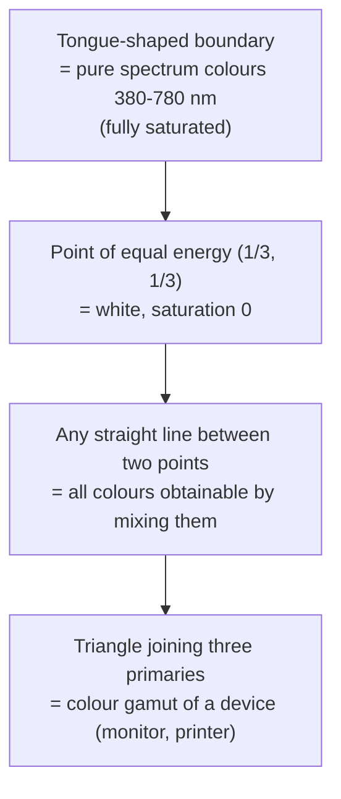
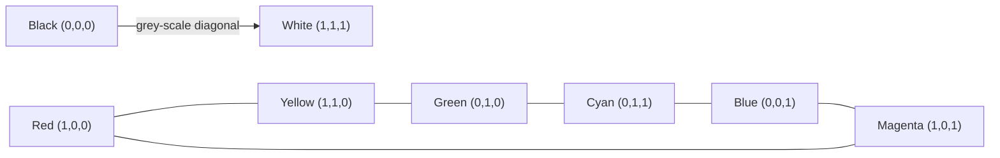
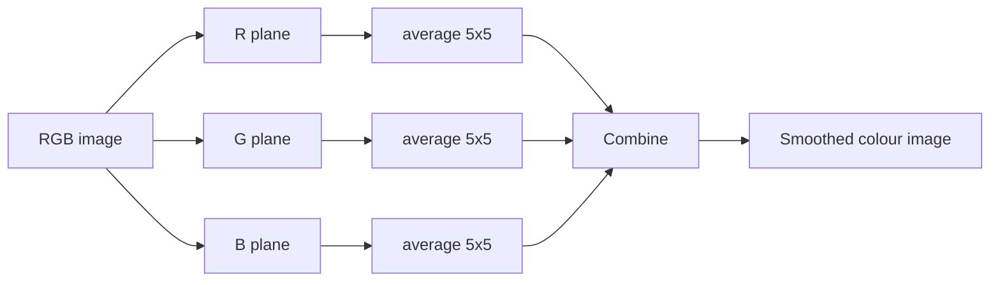
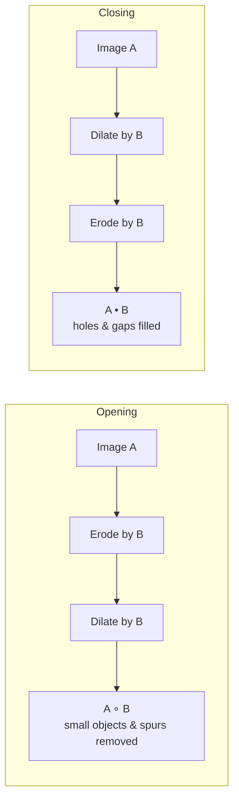

# Unit 3 · Colour Image Processing and Morphological Image Processing

> **Exam weight:** dilation/erosion/opening/closing is asked in **every** paper. RGB/HSI and conversions are next.

**Prefer to watch first?** [Video lectures for Unit 3 →](#videos/unit3)

## Part A · Colour image processing

## 3.1 Colour fundamentals

- **Why colour:** (1) colour is a powerful **descriptor** that simplifies object identification and extraction; (2) humans can tell thousands of colour shades apart but only about two dozen grey levels.
- **Full-colour** processing (images from colour cameras/scanners) vs **pseudo-colour** processing (assigning colours to grey levels or ranges).
- Sunlight through a prism gives a continuous spectrum: violet, blue, green, yellow, orange, red (400–700 nm).
- **Cones:** about 65% sensitive to red, 33% to green, 2% to blue (blue cones are the most sensitive individually). Hence the **primary colours of light: red (700 nm), green (546.1 nm), blue (435.8 nm)**.
- **Secondary colours of light:** magenta (R + B), cyan (G + B), yellow (R + G). Adding all three primaries gives white. Primary colours of **pigments** are cyan, magenta, yellow (subtractive).
- **Characteristics of colour:**
  - **Brightness:** achromatic notion of intensity.
  - **Hue:** the dominant wavelength, i.e. the colour as perceived (red, orange).
  - **Saturation:** relative purity, the amount of white mixed with the hue (pure spectrum colours are fully saturated; pink is less saturated than red).
  - Hue + saturation together = **chromaticity**.
- **Tristimulus values** X, Y, Z (amounts of red, green, blue needed). **Trichromatic coefficients:** x = X/(X+Y+Z), y = Y/(X+Y+Z), z = Z/(X+Y+Z), with x + y + z = 1.

### Chromaticity diagram  ⭐ (2018)
The CIE chromaticity diagram plots **x (red) on the horizontal axis and y (green) on the vertical axis**; z = 1 − (x + y) (blue).



**Usefulness in colour image processing:**
1. Shows colour composition as a function of x and y, without needing intensity.
2. Any colour inside the boundary can be specified; points on the boundary are pure, saturated colours.
3. Moving toward the equal-energy point means less saturation.
4. **Mixing:** any colour on the line joining two colours can be produced by mixing them.
5. **Gamut:** the triangle of three primaries shows all colours a monitor can show; no three fixed primaries can produce all visible colours (the triangle cannot cover the whole tongue).
6. Used for colour matching, device calibration and comparing the gamut of monitors and printers.

## 3.2 Colour models

A **colour model (colour space)** is a coordinate system and a subspace within it where each colour is a single point.

### RGB model  ⭐ (2019)
- Based on a **Cartesian coordinate system**; the colour subspace is a **unit cube**.
- R, G, B are at three corners; cyan, magenta, yellow at three other corners; **black at the origin (0,0,0)**, **white at (1,1,1)**.
- The **grey scale** lies on the **diagonal** from black to white (equal R, G, B).
- Each image consists of **three component images** (planes), one per primary. **Pixel depth** = bits per pixel; 8 bits per plane → **24-bit full-colour image** → 2<sup>24</sup> = 16,777,216 colours.
- **Safe RGB colours (web-safe):** 216 colours that display the same on all systems (6 values per component: 0, 51, 102, 153, 204, 255).
- **Used in:** monitors, cameras, scanners (hardware-oriented, additive).



### CMY and CMYK model
For printers (subtractive, pigments): **[C M Y]ᵀ = [1 1 1]ᵀ − [R G B]ᵀ**. Equal C, M, Y should give black but in practice gives muddy brown, so a fourth colour **black (K)** is added: **CMYK** (four-colour printing).

### HSI model  ⭐⭐ (2018, 2025-26)
RGB and CMY suit hardware but **do not match how humans describe colour**. Humans describe colour by **hue, saturation and brightness**. The **HSI (hue, saturation, intensity) model decouples intensity from the colour-carrying information** (hue and saturation), which makes it ideal for algorithms based on human colour perception.

- **Intensity:** on the vertical axis (the grey diagonal of the RGB cube stood on its black vertex).
- **Hue:** an **angle** around the vertical axis measured from red (red 0°, green 120°, blue 240°).
- **Saturation:** distance (length of the vector) from the vertical axis; 0 on the axis (grey), larger toward the edge.
- Shape: a triangle, circle or hexagon cross-section; the HSI space is a double cone/pyramid.

### RGB vs HSI (2018)

| RGB | HSI |
|---|---|
| hardware-oriented (monitors, cameras) | user-oriented, matches human perception |
| colour and intensity mixed in all 3 components | intensity separated from colour (H and S) |
| Cartesian cube | cylindrical/conical (angle, radius, height) |
| processing intensity changes colours | intensity can be processed without changing hue |
| additive mixing | describes colour as hue, purity, brightness |
| e.g. display on screens | e.g. histogram equalization of colour images, colour segmentation |

## 3.3 Converting between RGB and HSI  ⭐⭐ (2025-26)

### RGB → HSI (R, G, B normalised to [0, 1])

**H = θ if B ≤ G;   H = 360° − θ if B > G**

where **θ = cos<sup>−1</sup> { ½[(R − G) + (R − B)] / [(R − G)² + (R − B)(G − B)]<sup>1/2</sup> }**

**S = 1 − [3 / (R + G + B)] · min(R, G, B)**

**I = (R + G + B) / 3**

(H is usually normalised to [0, 1] by dividing by 360°.)

### HSI → RGB (three sectors of the hue circle)

**RG sector (0° ≤ H < 120°):**
B = I(1 − S);  R = I[1 + S cos H / cos(60° − H)];  G = 3I − (R + B)

**GB sector (120° ≤ H < 240°):** first H = H − 120°, then
R = I(1 − S);  G = I[1 + S cos H / cos(60° − H)];  B = 3I − (R + G)

**BR sector (240° ≤ H ≤ 360°):** first H = H − 240°, then
G = I(1 − S);  B = I[1 + S cos H / cos(60° − H)];  R = 3I − (G + B)

**Example:** pure red (1, 0, 0): θ = cos<sup>−1</sup>(½(1+1)/√1) = cos<sup>−1</sup>(1) = 0°, B ≤ G so H = 0°; S = 1 − 3·0/1 = 1; I = 1/3.

## 3.4 Colour transformations

g(x,y) = T[f(x,y)], with f and g colour vectors: s<sub>i</sub> = T<sub>i</sub>(r<sub>1</sub>, r<sub>2</sub>, …, r<sub>n</sub>), i = 1…n.
- **Intensity modification:** g = k·f. In HSI only I changes (s<sub>3</sub> = k r<sub>3</sub>); in RGB all three components change.
- **Colour complements:** hues opposite each other on the colour circle (like negatives); enhance detail in dark regions.
- **Colour slicing:** highlight colours in a range (inside a cube or sphere around a prototype colour), set the rest to neutral grey.
- **Tone and colour corrections:** for flat, light (high-key) or dark (low-key) images; colour balancing.
- **Histogram processing of colour images:** equalize **only the intensity (I) component** in HSI, leaving hue and saturation unchanged; equalizing R, G, B separately creates false colours.

## 3.5 Colour image smoothing and sharpening  ⭐ (2025-26)

### Smoothing by neighbourhood averaging
For a colour pixel vector **c(x,y) = [R, G, B]ᵀ** and neighbourhood S<sub>xy</sub> of K pixels:

**c̄(x,y) = (1/K) Σ<sub>(s,t)∈S<sub>xy</sub></sub> c(s,t)** = [ (1/K)ΣR, (1/K)ΣG, (1/K)ΣB ]ᵀ

So smoothing by neighbourhood averaging is done **per component plane**: smooth the R, G and B planes independently with the same mask, then recombine. (Smoothing just the I plane in HSI gives a similar but not identical result, because the averaging of two different colours creates a new hue in RGB.)



### Sharpening
Laplacian of a vector = Laplacian of each component: **∇²c = [∇²R, ∇²G, ∇²B]ᵀ**. Sharpen each plane and recombine (or sharpen only I in HSI).

## 3.6 Colour segmentation
- **In HSI:** hue describes the colour, saturation is used as a **mask** (threshold S to isolate coloured regions), then threshold H. Intensity is rarely used.
- **In RGB (better results):** choose a **prototype average colour a**; a pixel z belongs to the region if its distance D(z, a) ≤ D<sub>0</sub>. Euclidean distance (sphere), Mahalanobis distance (ellipsoid), or a **bounding box** (faster: |z<sub>i</sub> − a<sub>i</sub>| ≤ 1.25σ<sub>i</sub>).
- **Colour edge detection:** the gradient computed in vector space (Di Zenzo), not per channel.

## Part B · Morphological image processing

## 3.7 Introduction and set basics

**Morphology** is a tool for **extracting image components that are useful in the representation and description of region shape** (boundaries, skeletons, convex hull), and for pre/post-processing (filtering, thinning, pruning). The language is **set theory**: in a binary image the objects are sets of foreground (1) pixel coordinates in Z².

- **Structuring element (SE):** a small set/sub-image used to probe the image, with a defined **origin**.
- **Reflection:** B̂ = {w | w = −b, b ∈ B}. **Translation:** (B)<sub>z</sub> = {c | c = b + z}.
- **Logic operations on binary images:** AND (intersection), OR (union), NOT (complement), XOR, NOT-AND (difference A − B = A ∩ Bᶜ). Used to combine, mask and compare binary images.

## 3.8 Dilation and erosion  ⭐⭐⭐

### Dilation
**A ⊕ B = { z | (B̂)<sub>z</sub> ∩ A ≠ ∅ }**

The set of all displacements z such that the reflected SE overlaps A by **at least one** pixel.
- **Grows / thickens** objects; the extent is controlled by the SE.
- **Bridges gaps** (repairs broken characters in low-resolution text), fills small holes.

### Erosion
**A ⊖ B = { z | (B)<sub>z</sub> ⊆ A }**

The set of all points z such that B, translated by z, is **completely contained** in A.
- **Shrinks / thins** objects.
- **Removes** small objects and thin connections (irrelevant detail smaller than the SE).

**Duality:** (A ⊖ B)ᶜ = Aᶜ ⊕ B̂.

### Differences (Mid-2 2025)

| Dilation | Erosion |
|---|---|
| A ⊕ B = {z \| (B̂)<sub>z</sub> ∩ A ≠ ∅} | A ⊖ B = {z \| (B)<sub>z</sub> ⊆ A} |
| SE needs to **hit** (overlap) A | SE must **fit** inside A |
| expands / thickens objects | shrinks / thins objects |
| fills holes and gaps, joins broken parts | removes small objects, breaks thin bridges |
| boundary grows outward | boundary moves inward |
| like a **max** filter for grey-scale | like a **min** filter for grey-scale |
| background shrinks | background grows |
| application: repairing broken text | application: removing noise specks, separating touching objects |

### Binary example
A = 3×3 block of 1s plus one extra pixel on the right of its bottom row (inside a 6×6 frame); B = 3×3 square of 1s.

```
  A               A ⊕ B             A ⊖ B
0 0 0 0 0 0     1 1 1 1 1 0       0 0 0 0 0 0
0 1 1 1 0 0     1 1 1 1 1 0       0 0 0 0 0 0
0 1 1 1 0 0     1 1 1 1 1 1       0 0 1 0 0 0
0 1 1 1 1 0     1 1 1 1 1 1       0 0 0 0 0 0
0 0 0 0 0 0     1 1 1 1 1 1       0 0 0 0 0 0
0 0 0 0 0 0     0 0 0 0 0 0       0 0 0 0 0 0
```
Dilation grows the object by one pixel all round; erosion leaves only the pixel at which the whole 3×3 SE fits.

### Grey-scale dilation and erosion (2017 numerical)
For a flat SE: **dilation = maximum** over the neighbourhood, **erosion = minimum**. With a non-flat SE b: (f ⊕ b)(x,y) = max{f(x−s, y−t) + b(s,t)}, (f ⊖ b)(x,y) = min{f(x+s, y+t) − b(s,t)}.

Example with a flat 3×3 SE (borders replicated), A = 7 8 2 4 / 6 4 3 3 / 7 3 6 6 / 4 4 2 3:
- Dilation = 8 8 8 4 / 8 8 8 6 / 7 7 6 6 / 7 7 6 6
- Erosion = 4 2 2 2 / 3 2 2 2 / 3 2 2 2 / 3 2 2 2

## 3.9 Opening and closing  ⭐⭐⭐ (2018, 2025-26)

### Opening
**A ∘ B = (A ⊖ B) ⊕ B**  (erosion followed by dilation)

- **Smooths the contour** of an object, **breaks narrow isthmuses** (thin connections), **eliminates thin protrusions** and small objects.
- Geometric meaning: the union of all translates of B that **fit entirely inside A** (rolling the SE **inside** the boundary).
- Properties: A ∘ B ⊆ A; C ⊆ D ⇒ C ∘ B ⊆ D ∘ B; **(A ∘ B) ∘ B = A ∘ B (idempotent)**.

### Closing
**A • B = (A ⊕ B) ⊖ B**  (dilation followed by erosion)

- Also smooths contours, but **fuses narrow breaks and long thin gulfs**, **eliminates small holes**, and **fills gaps** in the contour.
- Geometric meaning: rolling the SE **outside** the boundary.
- Properties: A ⊆ A • B; C ⊆ D ⇒ C • B ⊆ D • B; **(A • B) • B = A • B (idempotent)**.

**Duality:** (A • B)ᶜ = (Aᶜ ∘ B̂).



**Morphological filtering (fingerprint example):** opening removes noise specks in the background; closing then fills the gaps in the ridges created by the opening. (A ∘ B) • B gives a clean fingerprint.

## 3.10 Hit-or-miss transform  ⭐ (2017)

A basic tool for **shape detection**: find where a specific pattern of foreground **and** background pixels occurs.

**A ⊛ B = (A ⊖ B<sub>1</sub>) ∩ (Aᶜ ⊖ B<sub>2</sub>)**, with B = (B<sub>1</sub>, B<sub>2</sub>)

- B<sub>1</sub> = the shape we want to find (must match the foreground of A).
- B<sub>2</sub> = the background around the shape (must match the background, i.e. the foreground of Aᶜ). Often B<sub>2</sub> = (W − X), a window minus the shape.
- The result contains the points where B<sub>1</sub> found a match in A **and** B<sub>2</sub> found a match in Aᶜ simultaneously. It finds **local patterns of pixels**: isolated points, end points, corners, specific shapes.
- It is the basis of thinning, thickening and pruning.

## 3.11 Basic morphological algorithms

| Algorithm | Formula | Meaning |
|---|---|---|
| **Boundary extraction** | β(A) = A − (A ⊖ B) | erode, then subtract from the original; gives a 1-pixel boundary with a 3×3 SE |
| **Region (hole) filling** | X<sub>k</sub> = (X<sub>k−1</sub> ⊕ B) ∩ Aᶜ, k = 1, 2, … | start from a point X<sub>0</sub> inside the hole; stop when X<sub>k</sub> = X<sub>k−1</sub>; result X<sub>k</sub> ∪ A. Intersection with Aᶜ is **conditional dilation** |
| **Connected components** | X<sub>k</sub> = (X<sub>k−1</sub> ⊕ B) ∩ A | start from a point of the component; stop when it stops changing. Used to count/label objects (e.g. bone fragments in X-rays) |
| **Convex hull** | X<sub>k</sub><sup>i</sup> = (X<sub>k−1</sub> ⊛ B<sup>i</sup>) ∪ A, i = 1…4 | iterate with four SEs until convergence; C(A) = ∪ D<sup>i</sup>. The smallest convex set containing A |
| **Thinning** | A ⊗ B = A − (A ⊛ B) | apply a sequence of 8 rotated SEs repeatedly until no change; reduces objects to **thin lines** of 1-pixel width |
| **Thickening** | A ⊙ B = A ∪ (A ⊛ B) | the dual of thinning; often done by thinning the background and complementing |
| **Skeleton** | S(A) = ∪<sub>k</sub> [(A ⊖ kB) − (A ⊖ kB) ∘ B] | the medial axis; A can be rebuilt from its skeleton subsets |
| **Pruning** | thinning + end-point removal | removes parasitic spurs left by thinning/skeletonisation |

**Thinning and skeleton in medical imaging (2019):** they reduce blood vessels, nerve fibres or bone structures to a one-pixel-wide centre line while keeping topology (connectivity, branches). This allows measuring vessel length, counting branch points in retinal images and angiograms, detecting stenosis, analysing chromosomes and fingerprints, and compressing shape information.
