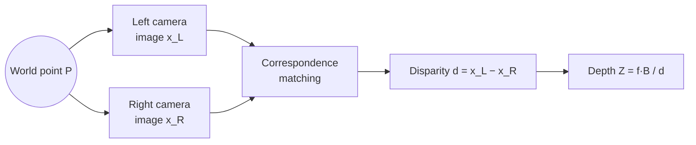
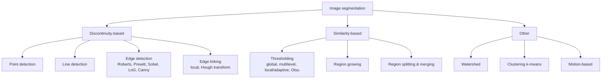
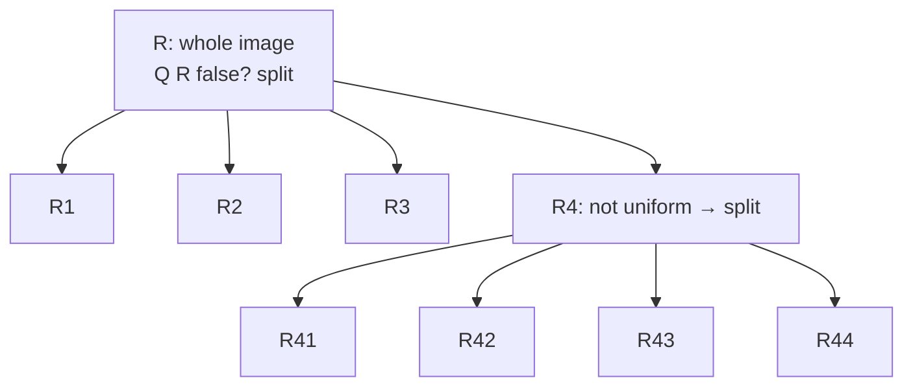
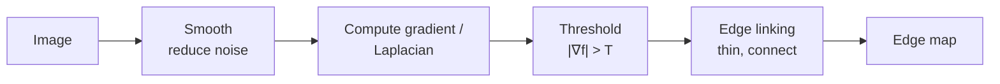

# Unit 4 · Registration and Segmentation

> **Exam weight:** segmentation (thresholding, region split-merge) and edge/line detection appear in every recent paper. Registration has never been asked, but it is in the syllabus; one 7-mark answer is enough.

**Prefer to watch first?** [Video lectures for Unit 4 →](#videos/unit4)

## Part A · Registration

## 4.1 Introduction

**Image registration** is the process of **aligning two or more images of the same scene** taken at different times, from different viewpoints or by different sensors, so that corresponding pixels represent the same physical point. One image is the **reference (fixed)** image; the other is the **sensed (moving)** image, which is geometrically transformed to match.

**Applications:** medical (aligning CT with MRI, before/after-treatment scans), remote sensing (change detection, mosaics), stereo vision (depth), motion tracking, image fusion, panoramas.


**Steps:** (1) feature detection (control points: corners, edges, region centroids); (2) feature matching (find correspondences); (3) estimate the mapping/transform from the matched pairs (least squares); (4) apply it with resampling and interpolation.

## 4.2 Geometric transformation (plane to plane)

A geometric transformation has two parts: (1) a **spatial transformation of coordinates** (x, y) = T{(v, w)}, and (2) **intensity interpolation** to assign values to the transformed pixels.

**Affine transform:** [x y 1] = [v w 1] · T, with T a 3×3 matrix:

| Transform | Matrix T (rows) | Equations |
|---|---|---|
| Identity | [1 0 0; 0 1 0; 0 0 1] | x = v, y = w |
| Scaling | [c<sub>x</sub> 0 0; 0 c<sub>y</sub> 0; 0 0 1] | x = c<sub>x</sub>v, y = c<sub>y</sub>w |
| Rotation | [cos θ sin θ 0; −sin θ cos θ 0; 0 0 1] | x = v cos θ − w sin θ, y = v sin θ + w cos θ |
| Translation | [1 0 0; 0 1 0; t<sub>x</sub> t<sub>y</sub> 1] | x = v + t<sub>x</sub>, y = w + t<sub>y</sub> |
| Shear (vertical) | [1 0 0; s<sub>v</sub> 1 0; 0 0 1] | x = v + s<sub>v</sub>w, y = w |
| Shear (horizontal) | [1 s<sub>h</sub> 0; 0 1 0; 0 0 1] | x = v, y = s<sub>h</sub>v + w |

Affine transforms preserve straight lines and parallelism. **Projective (perspective)** transforms need 8 parameters and map lines to lines but not parallel to parallel. **Bilinear warping:** x = c<sub>1</sub>v + c<sub>2</sub>w + c<sub>3</sub>vw + c<sub>4</sub>, y = c<sub>5</sub>v + c<sub>6</sub>w + c<sub>7</sub>vw + c<sub>8</sub>; four **tie points** give 8 equations for the 8 unknowns.

## 4.3 Mapping and interpolation
- **Forward mapping:** (x, y) = T{(v, w)} for every input pixel. Problems: two inputs can land on the same output, and some outputs get no value (holes).
- **Inverse mapping (preferred):** for every output pixel, compute (v, w) = T<sup>−1</sup>(x, y) and interpolate the input there.
- **Interpolation:** **nearest neighbour** (fast, blocky), **bilinear** (4 neighbours, v(x,y) = ax + by + cxy + d, smoother), **bicubic** (16 neighbours, sharpest, standard in Photoshop).

## 4.4 Stereo imaging
Two cameras separated by a **baseline B** view the same scene. A world point appears at slightly different positions in the left and right images; the difference is the **disparity d = x<sub>L</sub> − x<sub>R</sub>**.

**Depth: Z = f · B / d** (f = focal length). Large disparity = near object; small disparity = far object.



### Algorithms to establish correspondence
1. **Area (correlation)-based:** take a window around a point in the left image; slide it along the same row (the **epipolar line**) in the right image; choose the position with the best **normalised cross-correlation** or the least sum of squared differences (SSD/SAD). Gives a dense disparity map; fails in textureless regions.
2. **Feature-based:** detect edges, corners, line segments in both images and match features with similar attributes (orientation, strength, length). Sparse but reliable.
3. **Constraints used:** epipolar constraint (search only along one line), uniqueness, ordering, continuity/smoothness of disparity, limited disparity range.

### Algorithms to recover depth
From the matched pairs, compute disparity, then **triangulate**: Z = fB/d, X = x<sub>L</sub>Z/f, Y = yZ/f. Fill gaps by interpolation; refine with multi-baseline stereo, shape from shading, or structured light.

## Part B · Segmentation

## 4.5 Introduction  ⭐⭐ (2017, 2018)

**Segmentation** subdivides an image into its **constituent regions or objects**. It stops when the objects of interest have been isolated. It is one of the most difficult tasks, and its accuracy decides the success of recognition.

Formally, R is partitioned into R<sub>1</sub>…R<sub>n</sub> such that: (a) ∪R<sub>i</sub> = R; (b) each R<sub>i</sub> is connected; (c) R<sub>i</sub> ∩ R<sub>j</sub> = ∅; (d) Q(R<sub>i</sub>) = TRUE for each region (a uniformity predicate); (e) Q(R<sub>i</sub> ∪ R<sub>j</sub>) = FALSE for adjacent regions.

Two basic properties of intensity are used:
- **Discontinuity:** abrupt changes → **points, lines, edges** (edge-based).
- **Similarity:** regions alike by a criterion → **thresholding, region growing, splitting and merging** (region-based).



## 4.6 Region extraction and the pixel-based approach

**Region extraction** finds groups of pixels that form meaningful regions. In the **pixel-based approach**, each pixel is classified independently from its own value (and sometimes features like colour), usually by **thresholding** the histogram. It is fast, but it ignores spatial relations, so noise causes isolated misclassified pixels.

## 4.7 Thresholding  ⭐⭐⭐ (2025-26, Mid-2)

**g(x,y) = 1 if f(x,y) > T, 0 if f(x,y) ≤ T** (object vs background).

- **Global:** a single T for the whole image.
- **Variable / local / adaptive:** T depends on a neighbourhood (T = T(x, y, p(x,y), f(x,y))).
- **Multilevel:** several thresholds for several objects.

### Role of illumination and reflectance (2025-26 Q7a)
From f(x,y) = i(x,y) · r(x,y), the histogram of an image of an object on a background should have **two well-separated peaks** (bimodal), so one T works. If the **illumination is uneven** (e.g. a ramp of light), the product spreads and merges the peaks: the histogram is no longer bimodal and **global thresholding fails** (part of the background is classed as object). Remedies: (1) **correct the illumination** first, e.g. image a uniform white reflecting surface to get i(x,y), then divide f by it (f/i = r); (2) use **homomorphic filtering**; (3) use **local/adaptive thresholding**; (4) top-hat transformation. Noise (larger variance) and small objects also make the valleys shallow.

### Basic (iterative) global thresholding algorithm
1. Choose an initial estimate of T (e.g. the mean intensity).
2. Segment with T: **G<sub>1</sub>** = pixels > T, **G<sub>2</sub>** = pixels ≤ T.
3. Compute the mean values m<sub>1</sub> of G<sub>1</sub> and m<sub>2</sub> of G<sub>2</sub>.
4. New threshold **T = ½(m<sub>1</sub> + m<sub>2</sub>)**.
5. Repeat 2–4 until the change in T is smaller than ΔT.

**Worked example (2025-26):** image 5 3 9 / 2 1 7 / 8 4 2.
- Initial T = mean = 41/9 = 4.56.
- G<sub>1</sub> (> 4.56) = {5, 9, 7, 8}, m<sub>1</sub> = 29/4 = 7.25. G<sub>2</sub> (≤ 4.56) = {3, 2, 1, 4, 2}, m<sub>2</sub> = 12/5 = 2.4.
- New **T = (7.25 + 2.4)/2 = 4.825**.
- With T = 4.825 the groups are the same, so the algorithm has converged: **T ≈ 4.83**, G<sub>1</sub> = {5, 7, 8, 9}, G<sub>2</sub> = {1, 2, 2, 3, 4}.
- (If the paper asks you to start from T = 5 instead, G<sub>1</sub> = {9, 7, 8}, m<sub>1</sub> = 8; G<sub>2</sub> = {5, 3, 2, 1, 4, 2}, m<sub>2</sub> = 2.83; T = 5.42; repeating gives the same groups, so T ≈ 5.42.)

### Otsu's method (optimum global thresholding)
Chooses T that **maximises the between-class variance** σ²<sub>B</sub>(k) = [m<sub>G</sub>P<sub>1</sub>(k) − m(k)]² / [P<sub>1</sub>(k)(1 − P<sub>1</sub>(k))], computed entirely from the histogram. It needs no initial guess.

### Multilevel thresholding  ⭐ (Mid-2)
For images with **three or more** dominant modes (e.g. two objects on a background):

g(x,y) = a if f > T<sub>2</sub>;  b if T<sub>1</sub> < f ≤ T<sub>2</sub>;  c if f ≤ T<sub>1</sub>.

**Method:** (1) compute the histogram; (2) find the valleys between the peaks; place T<sub>1</sub>, T<sub>2</sub> (…) at the valleys, or extend Otsu to K classes by maximising σ²<sub>B</sub>(k<sub>1</sub>, k<sub>2</sub>) = Σ P<sub>k</sub>(m<sub>k</sub> − m<sub>G</sub>)²; (3) assign each pixel to a class by comparing with the thresholds; (4) label each class with a distinct grey value. **Limitation:** more than two thresholds becomes unreliable; noise and overlapping modes blur the valleys.

### Local (adaptive) thresholding
Compute T for each pixel from statistics of its neighbourhood S<sub>xy</sub>: **T<sub>xy</sub> = a·σ<sub>xy</sub> + b·m<sub>xy</sub>**, or partition the image into sub-images and threshold each separately. It handles **uneven illumination** (e.g. document scanning with shading).

## 4.8 Region-based segmentation  ⭐ (2025-26 Q8b)

### Region growing
Groups pixels into larger regions starting from **seed points**, adding neighbours that have similar properties (grey level within a range, colour, texture).
1. Select seed points (from the histogram peaks or prior knowledge).
2. For each seed, check its 8-neighbours; add a neighbour if |f(neighbour) − f(seed)| ≤ T (or another predicate).
3. Repeat for the newly added pixels until no more pixels qualify.
4. Problems: choosing seeds and the similarity criterion, and a stopping rule.

### Region splitting and merging
Starts from the **whole image** and works top-down with a **quadtree**.


*Fig.: Quadtree. Each node splits into four quadrants if its predicate Q is FALSE.*

**Algorithm:**
1. **Split** into four disjoint quadrants any region R<sub>i</sub> for which **Q(R<sub>i</sub>) = FALSE** (not uniform).
2. **Merge** any adjacent regions R<sub>j</sub> and R<sub>k</sub> for which **Q(R<sub>j</sub> ∪ R<sub>k</sub>) = TRUE**.
3. **Stop** when no further splitting or merging is possible.

**Predicate example:** Q = TRUE if σ<sub>R</sub> < a and 0 < m<sub>R</sub> < b (standard deviation and mean within limits), or if max − min ≤ ε.

**Advantages:** no seed needed; uses spatial information; good for textured images. **Disadvantage:** blocky boundaries from the quadtree.

## 4.9 Detection of discontinuities

Use a 3×3 mask: **R = Σ w<sub>k</sub> z<sub>k</sub>**.

### Point detection
Mask [−1 −1 −1; −1 8 −1; −1 −1 −1] (the Laplacian). A point is detected if **|R| ≥ T**. Coefficients sum to zero, so the response is zero in constant areas.

### Line detection  ⭐⭐ (2025-26, Mid-2)
Four masks, each responding most strongly to a 1-pixel-thick line in one direction (the preferred direction has larger weights = 2):

```
  Horizontal        +45°            Vertical         −45°
 -1 -1 -1        2 -1 -1         -1  2 -1        -1 -1  2
  2  2  2       -1  2 -1         -1  2 -1        -1  2 -1
 -1 -1 -1       -1 -1  2         -1  2 -1         2 -1 -1
```
(The +45° / −45° naming depends on the axis convention; write the diagonal clearly.)

**Method:** apply all four masks at each point, giving R<sub>1</sub> … R<sub>4</sub>. If **|R<sub>i</sub>| > |R<sub>j</sub>| for all j ≠ i**, the point is most likely on a line in direction i. To find all lines in one direction, apply that mask and threshold |R| ≥ T. Coefficients sum to zero.

### Edge detection  ⭐⭐ (2019, 2025-26)
An **edge** is a set of connected pixels on the boundary between two regions with different intensity. Models: **step edge** (ideal), **ramp edge** (real, blurred), **roof edge** (thin line).

- **First derivative** is non-zero along the ramp, so its **magnitude** detects an edge.
- **Second derivative** produces a **double response** with a **zero crossing** at the middle of the edge; its **sign** tells the dark/light side.



**Gradient:** ∇f = [G<sub>x</sub>, G<sub>y</sub>]ᵀ; magnitude M = √(G<sub>x</sub>² + G<sub>y</sub>²) ≈ |G<sub>x</sub>| + |G<sub>y</sub>|; direction α = tan<sup>−1</sup>(G<sub>y</sub>/G<sub>x</sub>) (the edge is perpendicular to the gradient).

**Edge operators (gradient masks):**
```
Roberts (2x2):     Gx: -1  0     Gy:  0 -1
                         0  1           1  0

Prewitt:  Gx: -1 -1 -1      Gy: -1  0  1
               0  0  0          -1  0  1
               1  1  1          -1  0  1

Sobel:    Gx: -1 -2 -1      Gy: -1  0  1
               0  0  0          -2  0  2
               1  2  1          -1  0  1
```
- **Roberts:** simplest, 2×2 diagonal differences, sensitive to noise.
- **Prewitt:** 3×3, simple averaging.
- **Sobel:** weight 2 in the centre gives **smoothing + differentiation**, so it is less sensitive to noise; the most used.
- **Laplacian of Gaussian (LoG, Marr-Hildreth):** smooth with a Gaussian, then take the Laplacian; edges are at **zero crossings**. The "Mexican hat" mask. ∇²G = [(x² + y² − 2σ²)/σ⁴] e<sup>−(x²+y²)/2σ²</sup>.
- **Canny (optimal):** (1) smooth with a Gaussian; (2) gradient magnitude and angle; (3) **non-maximum suppression** to thin edges; (4) **double thresholding + hysteresis** (T<sub>H</sub>, T<sub>L</sub> ≈ T<sub>H</sub>/2 or /3) and connectivity analysis. Criteria: low error rate, well-localised edges, single response.

### Pattern-fitting approach
Instead of differences, **fit a model surface** (e.g. a plane or a step edge model, Hueckel operator; or a bicubic polynomial, facet model) to the grey levels in a neighbourhood. An edge is declared where the fitted model has a large slope/step, and its parameters give edge position, orientation and contrast. It is more robust to noise but slower.

### Edge elements extraction by thresholding
Compute the gradient magnitude image, then **threshold** it: pixels with M(x,y) > T are **edge elements (edgels)**. A low T gives thick, noisy edges; a high T gives broken edges. Thresholding the gradient image **before** linking is common; hysteresis (two thresholds) gives better connected edges.

### Edge linking and edge following
Edge detection gives **broken** edges because of noise and uneven illumination. Linking joins them into meaningful boundaries.
1. **Local processing:** link pixels in a 3×3 or 5×5 neighbourhood if they have similar **gradient magnitude** (|M(s,t) − M(x,y)| ≤ E) and **direction** (|α(s,t) − α(x,y)| ≤ A).
2. **Edge following (tracking):** start at a strong edge point and move to the neighbouring edge pixel in the direction perpendicular to the gradient, continuing until the contour closes or ends. Graph search (minimum-cost path) is a global form.
3. **Global processing with the Hough transform:** each edge point (x, y) votes for all lines ρ = x cos θ + y sin θ passing through it in the (ρ, θ) accumulator; peaks in the accumulator are lines. Works even when edges are broken.

### Edge detector performance
Judged by: (1) **probability of false edges** (detecting noise as edge); (2) **probability of missing true edges**; (3) **error in localisation** (position) and in orientation; (4) robustness to noise; (5) single response per edge. **Pratt's figure of merit** F = (1/max(I<sub>I</sub>, I<sub>A</sub>)) Σ 1/(1 + αd<sub>i</sub>²) combines them (I<sub>I</sub> = ideal edge points, I<sub>A</sub> = detected, d = distance error). Canny > LoG > Sobel > Prewitt > Roberts in noise robustness.

### Corner detection
A **corner** is a point where the intensity changes strongly in **two** directions (the intersection of two edges). Used for registration, tracking and stereo matching.
- **Moravec:** shift a window in 4 directions; the corner response is the **minimum** sum of squared differences.
- **Harris:** structure matrix **M = Σ w(x,y) [I<sub>x</sub>² I<sub>x</sub>I<sub>y</sub>; I<sub>x</sub>I<sub>y</sub> I<sub>y</sub>²]**; response **R = det(M) − k (trace M)²** (k ≈ 0.04–0.06). Both eigenvalues large → corner (R large positive); one large → edge (R negative); both small → flat region.
