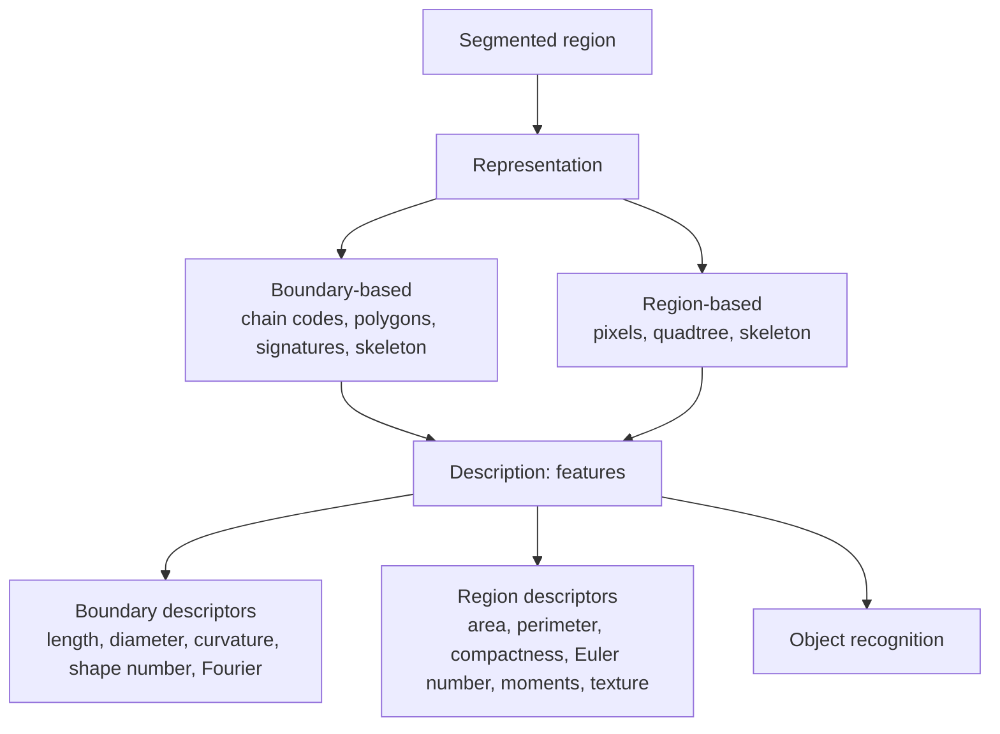
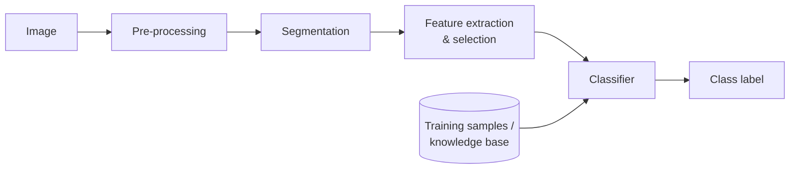

# Unit 5 · Feature Extraction, Description and Object Recognition

> **Exam weight:** low in recent papers (only 2017 asked representation/description and object recognition). Learn one solid answer each on representation & description and on recognition methods; that covers a possible question 8 or a short note.

**Prefer to watch first?** [Video lectures for Unit 5 →](#videos/unit5)

## 5.1 Representation

After segmentation, the pixels of a region must be **represented** in a form suited to computer processing:
- **External representation (boundary):** when the focus is on **shape** characteristics.
- **Internal representation (region):** when the focus is on **regional properties** such as colour and texture.

### Boundary following
Moore's algorithm traces the boundary pixel by pixel in clockwise order, giving an ordered list of boundary points.

### Chain codes (Freeman)
Represent a boundary as a sequence of **directions** of straight segments of fixed length.
- **4-directional:** 0 = right, 1 = up, 2 = left, 3 = down.
- **8-directional:** 0 to 7 in 45° steps.
- **Normalisation:** for a starting point, treat the code as a circular sequence and pick the smallest integer; for rotation, use the **first difference** (number of direction changes, counter-clockwise).
- **Example (4-directional):** a 2×1 rectangle traced anticlockwise from the lower-left corner: 0 0 1 2 2 3. First difference (circular, each value = (ci − ci−1) mod 4) = 1 0 1 1 0 1.

### Polygonal approximation
Approximate the boundary with a polygon of minimum perimeter (**MPP**, rubber band in cells), **merging** (add points until the fit error exceeds a threshold), or **splitting** (join two farthest points and split at the point of maximum perpendicular distance).

### Signatures
A 1-D function of the boundary, e.g. **distance from the centroid r(θ) vs angle θ**. A circle gives a constant; a square gives a periodic curve. Invariant to translation; normalised for scale.

### Skeletons
The **medial axis transform (MAT)**: for each point inside the region, find its nearest boundary points; if it has more than one, it is on the skeleton. Computed by thinning algorithms (Unit 3).

## 5.2 Topological attributes

**Topological properties** are those unaffected by any **rubber-sheet distortion** (stretching, rotation) as long as the figure is not torn or joined.
- **Number of holes H**.
- **Number of connected components C**.
- **Euler number E = C − H.** Letter "A": C = 1, H = 1, E = 0. Letter "B": C = 1, H = 2, E = −1.
- For polygonal networks: **V − Q + F = C − H = E** (vertices − edges + faces).

## 5.3 Geometric attributes

- **Area:** the number of pixels in the region.
- **Perimeter:** the length of its boundary.
- **Compactness = perimeter² / area** (dimensionless; minimum for a disk). **Circularity ratio Rc = 4πA/P²** (1 for a circle).
- **Centroid** (x̄, ȳ) = mean coordinates.
- **Diameter:** the maximum distance between any two boundary points; the line joining them is the **major axis**; the **minor axis** is perpendicular to it. **Eccentricity** = major/minor. **Basic rectangle** (bounding box aligned with the major axis).
- **Orientation:** the angle of the major axis.
- **Elongation**, **convexity**, **rectangularity**.

## 5.4 Boundary-based description

- **Length:** number of pixels on the boundary (diagonal steps count √2).
- **Diameter, major/minor axis, eccentricity**, as above.
- **Curvature:** rate of change of slope; convex segments (positive) and concave segments (negative).
- **Shape numbers:** the first difference of the chain code with the **smallest magnitude**; its **order n** is the number of digits. Used to compare shapes.
- **Fourier descriptors:** treat each boundary point as a complex number s(k) = x(k) + j·y(k); the DFT coefficients a(u) describe the shape. **Low-order coefficients give the general shape**; high orders give fine detail. Simple to normalise for rotation, translation, scale and starting point.
- **Statistical moments** of the boundary segment treated as a 1-D function: mean, variance, higher moments describe its shape.

## 5.5 Region-based description

- **Area, perimeter, compactness, circularity**, as above.
- **Topological descriptors:** Euler number.
- **Texture:**
  - **Statistical:** moments of the intensity histogram: mean, variance, **smoothness R = 1 − 1/(1 + σ²)**, third moment (skewness), **uniformity U = Σ p²**, **entropy e = −Σ p log₂ p**.
  - **Co-occurrence matrix (GLCM):** counts how often pairs of grey levels occur at a given displacement; descriptors: contrast, correlation, energy, homogeneity, entropy.
  - **Spectral:** peaks in the Fourier spectrum show the direction and period of a texture pattern.
- **Moment invariants (Hu):** normalised central moments ηpq combined into **seven moments φ1…φ7 invariant to translation, rotation and scale**. Example: φ1 = η20 + η02.
- **Principal components (Hotelling transform):** align the region with its eigenvectors for rotation normalisation.

## 5.6 Relationships (relational descriptors)

Describes how the parts of an object are **arranged** relative to one another, using **strings, trees or graphs**: e.g. a staircase as a string "abababab" of two primitive elements; a region as a tree where nodes are regions and edges mean "inside of". Relational descriptors are the input to **syntactic** recognition and **graph matching**.

**Feature selection (2017):** choose a small set of features that best separates the classes: discard redundant/correlated features, prefer invariant ones (to rotation, scale, translation), use criteria such as class separability (Fisher ratio), **PCA** for dimensionality reduction, and sequential forward/backward selection.

## 5.7 Object recognition

**Recognition** assigns a **label (class)** to an object from its descriptors. A **pattern** is an arrangement of descriptors; a **pattern class** ω1…ωW is a family of patterns sharing properties. Patterns are written as **vectors x = [x1 … xn]ᵀ** (quantitative) or as **strings/trees** (structural).

### Deterministic (decision-theoretic) methods
Use **decision functions** di(x): x belongs to ωi if di(x) > dj(x) for all j ≠ i. The **decision boundary** is di(x) − dj(x) = 0.
- **Minimum distance classifier:** compute each class mean mj; assign x to the class with the nearest mean: dj(x) = xᵀmj − ½mjᵀmj. Works when the classes are compact and well separated (e.g. bank-cheque character recognition, E-13B font).
- **Matching by correlation (template matching):** slide a template over the image and compute the normalised correlation coefficient γ(x,y); the maximum gives the best match.

### Clustering (unsupervised)
When class labels are not known, group feature vectors by similarity.
- **K-means:** (1) choose K initial centres; (2) assign each sample to the nearest centre; (3) recompute each centre as the mean of its samples; (4) repeat until the centres stop moving.
- Hierarchical (agglomerative) clustering, ISODATA.
- Used for colour segmentation, unsupervised land-cover classification.

### Statistical classification
- **Bayes classifier (optimum):** minimises the average probability of misclassification. Assign x to ωj if **p(x|ωj)P(ωj) > p(x|ωi)P(ωi)** for all i ≠ j. For **Gaussian** pattern classes: dj(x) = ln P(ωj) − ½ ln|Cj| − ½[(x − mj)ᵀCj−1(x − mj)]. With equal covariance and priors it reduces to the minimum-distance classifier.
- **Neural networks:** perceptrons and multilayer feed-forward networks trained by back-propagation learn the decision functions from training samples.
- Applications: multispectral remote-sensing classification (water, vegetation, urban), OCR.

### Syntactic (structural) recognition
Patterns are described by **primitives** and **grammar rules** (like a language).
- **String grammars:** a shape is a string of primitives (e.g. line segments a, b); a **grammar G = (N, Σ, P, S)** (non-terminals, terminals, production rules, start symbol) generates the valid strings of a class; recognition = **parsing** the string with an automaton.
- Example: a chromosome boundary coded as a string; the grammar for "submedian chromosome" accepts it.
- Suited to objects with a **clear structure** (characters, chromosomes, fingerprints, circuit diagrams).

### Tree search
Represent the object's parts as a **tree** (or the search space as a tree of hypotheses). Recognition searches the tree (depth-first, breadth-first, best-first, A*) for the path that best matches the scene, pruning branches that violate constraints. **Interpretation tree:** each level assigns a scene feature to a model feature; constraints (distances, angles) prune inconsistent branches.

### Graph matching
Represent the object as a **relational graph**: nodes = parts/regions with attributes (area, colour), edges = relations (adjacent, above, inside). Recognition = finding the **best (sub)graph isomorphism** between the scene graph and a model graph, by searching for the maximal clique of the association graph or by minimising a matching cost. It tolerates missing parts and distortions.
